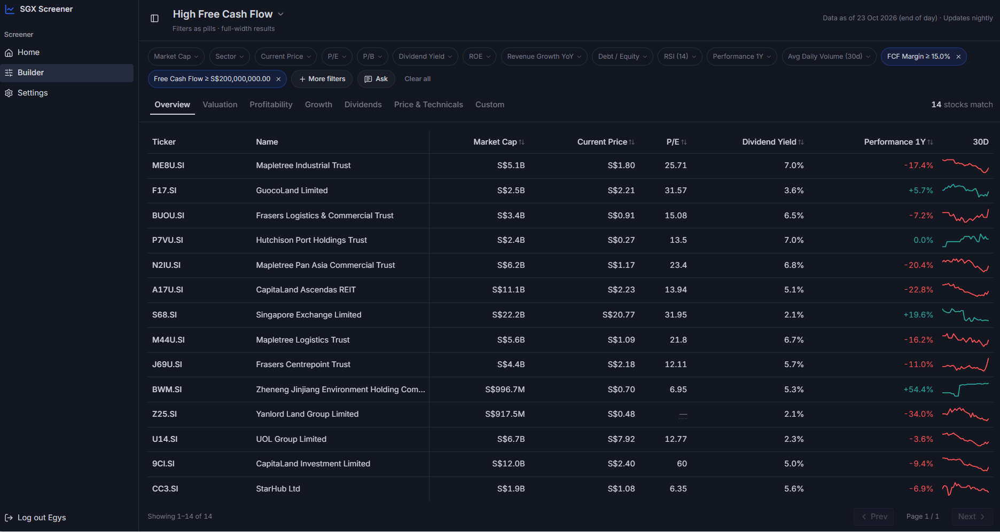
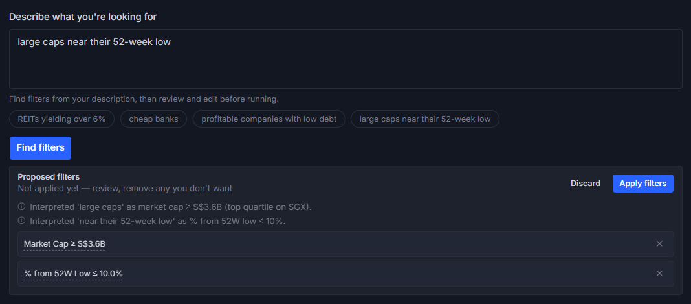
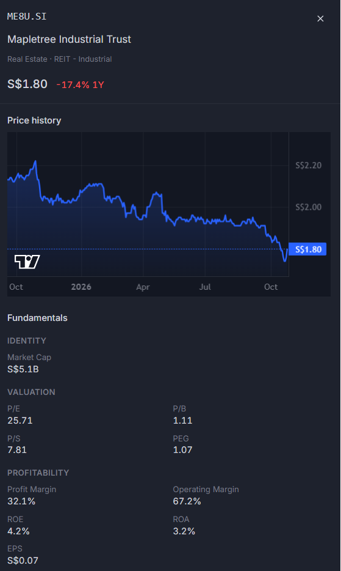
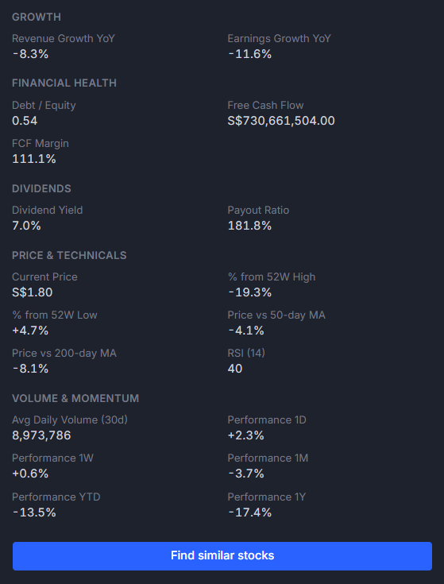

# SGX Screener

A stock screener for Singapore Exchange (SGX) equities. Build a screen from filter pills, start from one of 12 curated presets, or describe what you want in plain English. The screener turns it into filters you can review and edit before anything runs.





<p>
  
  
</p>

## What it does

- **Filter builder.** About 30 fields (valuation, profitability, growth, balance sheet, dividends, price and technicals, plus sector and industry), each a pill with data-derived quick options. A live match count updates as you edit.
- **12 curated presets**, such as High-Yield Blue Chips, GARP and Oversold Quality. They load into the builder and stay fully editable.
- **Natural-language screening.**
  - *Parse:* describe a screen ("profitable banks with a yield above 5%"). `@`-mention a stock to use its own numbers as reference points.
  - *Refine:* ask for changes to the current screen. Each proposed add/modify/remove is accepted or rejected individually.
  - *Describe:* generates a name and summary when you save.
- **Results table** in the style of TradingView: column tabs (Overview, Valuation, Profitability, Growth, Dividends, Price & Technicals, and a Custom tab you build yourself), sorting, pagination, 30-day sparklines and CSV export.
- **Detail drawer** with a price chart, key metrics and "Find similar stocks".
- **Saved screens and share links.** Logged-in users save, rename, copy and reopen named screens. Anyone can share a screen as a `?spec=` URL, which is validated before it's applied.

## Architecture

```
                 nightly (21:00 SGT) + catch-up on boot
 Yahoo Finance ─────────────────────────────────────────► ingest ──► PostgreSQL
                                                                     (writer role)
                                                                          │
                                                                          ▼
 Browser ──► Express API ──► Zod-validated Filter DSL ──► compiler ──► parameterized SQL
   (React)        │                    ▲                               (read-only role)
                  └──► LLM (OpenRouter) ┘
                       emits DSL only
```

npm workspaces, three packages:

| Package | Role |
|---|---|
| `packages/contract` | The Filter DSL, field definitions, 12 presets and every request/response schema (Zod). Imported by both apps as TypeScript source, so client and server can't drift. |
| `backend` | Express 5 + Drizzle ORM on PostgreSQL. DSL compiler, query endpoints, NL endpoints, nightly ingest, accounts and saved screens. |
| `frontend` | React 19 + Vite + Tailwind + shadcn/ui. Filter pills, column tabs, Tiptap editor with `@`-mention stock references, lightweight-charts. |

### Decision: the LLM emits a Filter DSL, never SQL

The model's output is never trusted as code. It writes the same small JSON language that the builder, the presets and share links produce:

```json
{ "conditions": [
    { "field": "dividend_yield", "operator": "gt", "value": 0.05 },
    { "field": "sector", "operator": "in", "value": ["Financial Services"] }
  ],
  "sort": { "field": "market_cap", "direction": "desc" } }
```

The server then:

1. **Validates the DSL with Zod** (`packages/contract/src/dsl.ts`). Fields come from a closed enum; operators are `gt | gte | lt | lte | eq | between | in`; and each operator's value shape is enforced (for example, `between` must be `[min, max]`). Anything malformed is rejected with a 400. For NL output, there's one repair pass and then the request fails.
2. **Compiles it to SQL** (`backend/src/services/screen/compile.ts`). Every field maps through a fixed `FIELD_COLUMN` table to a Drizzle column, so the model can't name a table or column. Values are always bound as parameters, never concatenated into SQL.
3. **Runs it on a read-only connection.** Request-time screening queries use a separate pool (`READONLY_DATABASE_URL`). It's meant to log in as a role with `SELECT` on the four market-data tables only (`backend/sql/create-readonly-role.sql`). Every session on that pool is also opened with `default_transaction_read_only=on`, so Postgres refuses writes even when the pool falls back to the writer URL in local development.

On top of that, NL proposals are staged for review rather than applied automatically. Sector and industry values are checked against the live facet list, with known synonyms mapped and unknown values dropped with a warning, so a hallucinated label can't silently produce an empty screen.

Why not let the model write SQL? Generated SQL would need sandboxing and a parser to inspect it, and could still produce queries that are valid but wrong, with nothing to show the user. A DSL makes the model's output small enough to validate completely. It also makes the result editable: an NL proposal arrives as the same pills the user would have built by hand.

### Decision: nightly ingestion, request-time reads only

No request ever calls Yahoo Finance. All market data arrives through a scheduled ingest, and the API only reads what's already in Postgres.

- **Ingest (write path).** `backend/src/services/ingest/` runs at 21:00 Singapore time, after the SGX close. It fetches prices and fundamentals, computes ratios and technicals (RSI-14, moving averages, 52-week distances, performance windows), and upserts one denormalised `screener_metrics` row per company.
  - An **SGX session guard** never stamps an open trading session as a close. Bars and `as_of` stop at the last *completed* session.
  - A **completeness guard** deactivates companies that come back without a market cap.
  - **Catch-up on boot** re-runs ingest in the background if the newest `as_of` lags the last completed session, so downtime heals itself.
- **Screening (read path).** Count and results queries hit one indexed table joined to `companies`, so live counts stay fast. Yahoo rate limits, outages and slow responses can't affect a user's request, and every response carries the `as_of` date it reflects.

The trade-off is freshness: data is end-of-day, and the UI says so.

### The universe

The screener covers SGD-denominated SGX equities and trusts with a market cap of at least about S$300M: 179 candidates, 174 validated against Yahoo Finance, and 173 with complete data after the latest ingest (the completeness guard deactivates any that come back without a market cap). The S$300M floor comes from a coverage study of SGX's own securities list. Fundamentals coverage collapses below that size (see [docs/universe-coverage-study.md](docs/universe-coverage-study.md)). Screening thresholds in the NL glossary and the quick-filter bands are percentiles computed from live data (`npm run nl:glossary`), not hand-picked numbers.

## Local setup

**Prerequisites:** Node.js 20+, PostgreSQL 14+ (or Docker), and optionally an [OpenRouter](https://openrouter.ai) API key for natural-language screening.

```bash
# 1. Install all workspaces
npm install

# 2. Configure the API
cp backend/.env.example backend/.env
#    then edit backend/.env: at minimum DATABASE_URL and JWT_SECRET (openssl rand -hex 32)

# 3. Start Postgres (or point DATABASE_URL at your own)
docker compose up -d

# 4. Create tables and the read-only role, then load the SGX universe
cd backend
npm run db:migrate
psql "$DATABASE_URL" -v ro_password="'choose-a-password'" -f sql/create-readonly-role.sql
#    then set READONLY_DATABASE_URL in backend/.env to use that role
npm run seed:universe

# 5. Populate market data (first run takes a few minutes; Yahoo is throttled)
npm run ingest:run

# 6. Run the API (http://localhost:3000) and, in another terminal, the web app (http://localhost:3001)
npm run dev
cd ../frontend && npm run dev
```

The Vite dev server proxies `/api` to `localhost:3000`, so the frontend needs no environment variables. For NL screening without an API key, set `NL_PARSE_STUB=true` in `backend/.env`. That returns canned responses for local demos only.

### Environment

Every variable is documented in [`backend/.env.example`](backend/.env.example):

| Variable | Required | Purpose |
|---|---|---|
| `DATABASE_URL` | yes | Writer connection: migrations, ingest, accounts, saved screens |
| `READONLY_DATABASE_URL` | recommended | Read-only role for request-time screening (falls back to `DATABASE_URL`, still read-only per session) |
| `JWT_SECRET` | yes | Signs the session cookie |
| `CLIENT_URL` | dev | CORS origin of the web app |
| `OPENROUTER_API_KEY` / `OPENROUTER_MODEL` | for NL | Any OpenAI-compatible model via OpenRouter |
| `CRON_INGEST_SCHEDULE` / `CRON_INGEST_TIMEZONE` | no | Default `0 21 * * *`, `Asia/Singapore` |
| `INGEST_CATCHUP_ON_BOOT` | no | Default `true` |

### Scripts

| Where | Command | What it does |
|---|---|---|
| root | `npm test` | All unit tests (Vitest: 102 backend + 21 frontend) |
| root | `npm run build` | Typecheck the API and build the web app |
| `backend` | `npm run dev` | API with reload |
| `backend` | `npm run test:integration` | Database-backed tests (needs a migrated, seeded, ingested DB) |
| `backend` | `npm run db:migrate` / `db:generate` | Apply / generate Drizzle migrations |
| `backend` | `npm run seed:universe` | Upsert the validated SGX universe |
| `backend` | `npm run ingest:run` | One full ingest pass |
| `backend` | `npm run nl:glossary` | Regenerate the percentile glossary and filter bands from live data |
| `frontend` | `npm run dev` / `build` | Vite dev server / production build |

The API runs TypeScript directly through `tsx` in both development and production (`npm start`), because it imports the contract package as source.

## Limitations

- **End-of-day data only.** There's no intraday data.
- **Coverage stops at about S$300M market cap and SGD listings.** Smaller companies and non-SGD listings are out of scope.
- **Mainboard vs Catalist isn't verified.** Yahoo doesn't expose the board, so every company is recorded as Mainboard.
- **NL quality depends on the configured model.** The DSL boundary bounds what the model can *do*, not how well it understands you.

## Project context

This started as my feature in a 4-person team project at Nanyang
Polytechnic (May–Oct 2026), where I was project lead. I owned the screener
end to end — ingestion, the Filter DSL and its compiler, the query layer
and the UI — and extracted it here as a standalone application.

The original monorepo also contained features built by my teammates — the
dashboard and stock comparison views (Pravin), reports (Umang) and
watchlist (Ridzwan) — which are not included here. The original monorepo is
private, as coursework repositories are at NYP.
